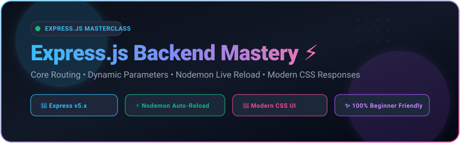
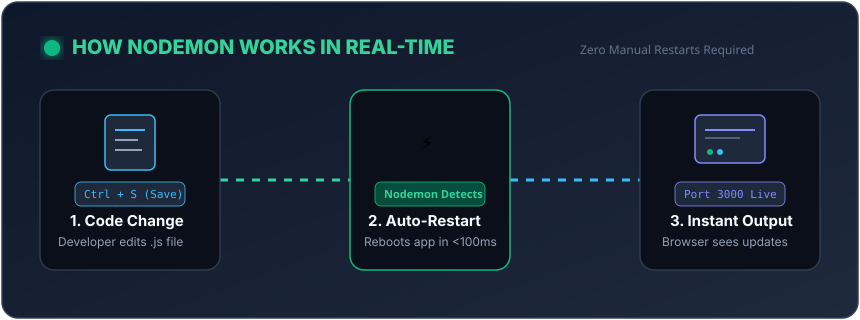

<div align="center">

<!-- ANIMATED HERO BANNER -->


<br/><br/>

[](https://nodejs.org/)
[](https://expressjs.com/)
[](https://nodemon.io/)
[](https://developer.mozilla.org/en-US/docs/Web/CSS)
[](https://opensource.org/licenses/ISC)

<p align="center">
  <b>The friendliest, most visual hands-on guide to mastering Express.js from scratch.</b><br>
  No confusing jargon. Real-life analogies, animated diagrams, modern CSS responses, and instant live reload with <b>Nodemon</b>.
</p>

[⚡ Quick Start](#-quick-start) • [🎡 Request Cycle (Animation)](#-animated-request--response-lifecycle) • [🔄 Nodemon (Animation)](#-animated-nodemon-guide) • [📚 Easy Lessons](#-easy-curriculum-breakdown) • [📊 Params vs Query](#-params-vs-query-strings-visual-guide)

---

</div>

## 🧠 Express.js Explained in Plain English (Real-Life Analogy)

Imagine you are opening a **Modern Restaurant**:

| Real-Life Restaurant 🍔 | Express.js Equivalent 💻 | What It Does |
| :--- | :--- | :--- |
| **The Restaurant Building** | `const app = express()` | The main application container that holds everything together. |
| **The Address / Door Number** | `const PORT = 3000` | Where customers (browsers) go to find you (`localhost:3000`). |
| **Turning On the "OPEN" Sign** | `app.listen(PORT, ...)` | Starts the server so it can accept visitors and orders. |
| **The Front-Door Greeter** | `app.use((req, res) => ...)` | Greets **every single person** who steps in, regardless of what they want. |
| **The Menu Categories** | `app.get('/apple', ...)` | **Routing**: When someone asks for an apple, you serve the apple dish. |
| **Customer's Order Slip** | `req` (Request Object) | Tells you what the user requested, who they are, and what data they sent. |
| **Delivering Food to the Table** | `res.send(...)` | **Response**: Hands back data, styled HTML, or JSON to the customer. |
| **The Automatic Kitchen Assistant** | `nodemon` | Automatically restarts the kitchen whenever you change a recipe! |

---

## 🎡 Animated Request & Response Lifecycle

Here is exactly how a request travels back and forth when you visit an Express URL:

<div align="center">
  
</div>

1. **Client (Browser)** sends a request: `GET http://localhost:3000/apple`.
2. **Express Server** receives it and runs any `app.use()` middleware.
3. Express matches the route `app.get("/apple", ...)`.
4. Handler triggers `res.send()` to package the modern HTML response and deliver it back to your screen.

---

## ⚡ Animated Nodemon Guide

### 😫 Without Nodemon (The Old Painful Way)
Every time you changed 1 line of code:
1. Switch to terminal &rarr; Press `Ctrl + C` (Kill server).
2. Re-type `node 01_index.js` &rarr; Press `Enter`.
3. Switch back to browser &rarr; Refresh page.
*(Repeating this 100 times a day wastes hours!)*

### 🚀 With Nodemon (The Smart Modern Way)
Save your file with `Ctrl + S`, and **Nodemon automatically reboots your server in under 100 milliseconds!**

<div align="center">
  
</div>

### How to Use Nodemon in This Repository

We have already configured pre-built npm scripts for every lesson in `package.json`:

```bash
# Run 01_index.js with auto-reload
npm run dev

# Or pick any lesson:
npm run dev:01    # Lesson 01 - Server Basics
npm run dev:02    # Lesson 02 - Handling Requests
npm run dev:03    # Lesson 03 - Sending Responses with Modern CSS
npm run dev:04    # Lesson 04 - Multi-Path Routing
npm run dev:05    # Lesson 05 - Path Parameters (:username/:id)
npm run dev:06    # Lesson 06 - Query Strings (?q=...)
```

<details>
<summary><b>🛠️ Click to view the custom <code>nodemon.json</code> configuration</b></summary>

```json
{
  "restartable": "rs",
  "ignore": [".git", "node_modules/**/node_modules"],
  "verbose": true,
  "watch": ["*.js"],
  "ext": "js,json,html,css",
  "delay": 300
}
```
* **Type `rs`** in your running terminal to manually reboot the server at any moment!
* **Debounce (`300ms`)** ensures rapid saves do not cause server stutter.
</details>

---

## 🎨 Modern CSS in Express Responses

Rather than sending boring black-and-white plain text (`res.send("Hello World")`), every lesson in this repo sends **rich, modern UI cards**:

* **✨ Glassmorphism**: Translucent frosted glass effect using `backdrop-filter: blur(12px)`.
* **🎨 CSS Custom Properties**: Reusable `--bg-gradient`, `--accent-gradient`, and theme tokens.
* **📱 Responsive Layouts**: Centered Flexbox and CSS Grid that fit beautifully on any screen.
* **🌙 Dark Mode Aesthetics**: Slate `#0f172a` backdrop with vibrant neon accents (`#38bdf8`, `#10b981`, `#ec4899`).

---

## 📚 Easy Curriculum Breakdown

### 🟢 Lesson 01: Creating Your First Server (`01_index.js`)

**Goal**: Turn on the server and listen for connections on port 3000.

```javascript
const express = require("express");
const app = express();
const PORT = 3000;

// Listen on port 3000
app.listen(PORT, () => {
    console.log(`Server is running at http://localhost:${PORT}`);
});
```
* **Run with Nodemon**: `npm run dev:01`
* **Test in Browser**: [http://localhost:3000](http://localhost:3000)

---

### 🟢 Lesson 02: Handling Requests with `app.use()` (`02_handling_request.js`)

**Goal**: Intercept every incoming visitor and inspect what they asked for.

```javascript
app.use((req, res) => {
    console.log(`Incoming request method: ${req.method} on URL: ${req.url}`);
    res.send("<h1>Request handled successfully!</h1>");
});
```

> [!NOTE]
> **Why `res.send()` is mandatory**: If you don't send a response back, the client's browser spinner will spin endlessly until it times out!

* **Run with Nodemon**: `npm run dev:02`
* **Test in Browser**: [http://localhost:3000](http://localhost:3000)

---

### 🟢 Lesson 03: What Can `res.send()` Transmit? (`03_send_response.js`)

**Goal**: Learn the 3 types of content `res.send()` can return:

1. **Plain Text**: `res.send("Welcome!")`
2. **JSON Object**: `res.send({ status: 200, user: "Sahil" })` *(Auto-sets `Content-Type: application/json`)*
3. **HTML with Modern CSS**: Full styled webpage with buttons, cards, and animations!

* **Run with Nodemon**: `npm run dev:03`
* **Test in Browser**: [http://localhost:3000](http://localhost:3000)

---

### 🟢 Lesson 04: Routing & Custom 404 Pages (`04_routing.js`)

**Goal**: Deliver different pages for different URLs (`/`, `/apple`, `/orange`), and catch broken links with a **404 Page**.

```javascript
// Specific Routes
app.get("/", (req, res) => res.send("🏠 Home Page"));
app.get("/apple", (req, res) => res.send("🍎 Apple Page"));
app.get("/orange", (req, res) => res.send("🍊 Orange Page"));

// 404 Catch-All (must be placed at the very bottom!)
app.use((req, res) => {
    res.status(404).send("❌ 404 - Page Not Found");
});
```

* **Run with Nodemon**: `npm run dev:04`
* **Test Routes**:
  * Home: [http://localhost:3000/](http://localhost:3000/)
  * Apple: [http://localhost:3000/apple](http://localhost:3000/apple)
  * Orange: [http://localhost:3000/orange](http://localhost:3000/orange)
  * Broken Route (404): [http://localhost:3000/random](http://localhost:3000/random)

---

## 📊 Params vs. Query Strings (Visual Guide)

This visual infographic shows you exactly when to use **Path Parameters** vs. **Query Strings**:

<div align="center">
  
</div>

---

### 🟢 Lesson 05: Dynamic Path Parameters (`05_path_parameter.js`)

**Goal**: Read dynamic variables directly from the URL path using colons (`:username`, `:id`).

```javascript
// URL: /sahil/101
app.get("/:username/:id", (req, res) => {
    const { username, id } = req.params;
    res.send(`<h1>Welcome @${username} (ID: #${id})</h1>`);
});
```

* **Run with Nodemon**: `npm run dev:05`
* **Test in Browser**:
  * [http://localhost:3000/sahil/101](http://localhost:3000/sahil/101)
  * [http://localhost:3000/coder/999](http://localhost:3000/coder/999)

---

### 🟢 Lesson 06: Query Strings & Search Form (`06_query_string.js`)

**Goal**: Extract optional parameters that appear after `?` in the URL (e.g. `/search?q=javascript`).

```javascript
app.get("/search", (req, res) => {
    const { q } = req.query;
    
    // Safety check if user didn't type anything
    if (!q) {
        return res.send("⚠️ Nothing searched! Please provide ?q=value");
    }
    
    res.send(`🔍 Search results for: ${q}`);
});
```

* **Run with Nodemon**: `npm run dev:06`
* **Test in Browser**:
  * Interactive Search Home: [http://localhost:3000/](http://localhost:3000/)
  * Direct Query: [http://localhost:3000/search?q=express](http://localhost:3000/search?q=express)
  * Missing Query Test: [http://localhost:3000/search](http://localhost:3000/search)

---

## 🛠️ Code Fixes Implemented in this Project

Here is what was missing or broken in the starter code and how it was fixed:

| File | What was Missing / Broken? | How it Was Fixed |
| :--- | :--- | :--- |
| **`02_handling_request.js`** | 💥 **Crashed Immediately**: Had no `express`, no `app`, no `listen()`, and never sent a response (browser would freeze). | Added full Express initialization, request logging (`req.method`, `req.url`), modern CSS response, and `app.listen()`. |
| **`05_path_parameter.js`** | ⚠️ Typo: `"page pf @"` &rarr; `id` was extracted but never displayed &rarr; No home route `/`. | Fixed typo to `"page of @"`, displayed both username and ID in an avatar profile card, and added a home navigation page. |
| **`06_query_string.js`** | ⚠️ Going to `/` gave 404 &rarr; Going to `/search` without `?q=` printed `"undefined"`. | Added interactive modern search form on `/`, handled empty queries safely with a warning alert. |
| **`package.json`** | ❌ No Nodemon installed and zero dev scripts. | Added `nodemon` (`^3.1.14`), configured `npm run dev:*` commands, and built `nodemon.json`. |
| **`.gitignore`** | ❌ Missing: `node_modules/` was being tracked in Git. | Added `.gitignore` to keep repository clean and lightweight. |

---

## ⚡ Quick Start

### 1. Clone & Install
```bash
git clone https://github.com/Sahilssr1/Learn_ExpressJs.git
cd Learn_ExpressJs
npm install
```

### 2. Run with Live Reload
```bash
# Run any lesson
npm run dev:01
```

Open [http://localhost:3000](http://localhost:3000) in your browser. Any change you save will automatically refresh!

---

## 👨‍💻 Author & License

* **Created by**: **Sahil** ([@Sahilssr1](https://github.com/Sahilssr1))
* **License**: [ISC](https://opensource.org/licenses/ISC)
* Feel free to star ⭐ this repository if it helped you learn Express.js!
